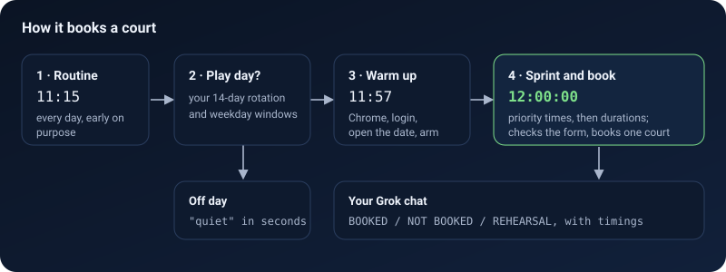

<p align="center">
  <picture>
    <source media="(max-width: 600px)" srcset="assets/hero-mobile.svg">
    
  </picture>
</p>

<h1 align="center">PickleTime Bot: automatic CourtReserve court booking for Grok Bot</h1>

<p align="center">
  <a href="https://github.com/kapadias/pickletime-grokbot/releases"></a>
  <a href="https://github.com/kapadias/pickletime-grokbot/actions/workflows/ci.yml"></a>
  <a href="LICENSE"></a>
  
  
</p>

<p align="center">
  <a href="#start">Start</a> ·
  <a href="#how-it-works">How it works</a> ·
  <a href="#what-protects-you">Safety</a> ·
  <a href="#faq">FAQ</a> ·
  <a href="SETUP.md">Full runbook</a>
</p>

**PickleTime Bot books your pickleball court on CourtReserve the second it is
released**, from a [Grok Bot](#start), and tells you in your Grok chat. Good
courts at busy clubs go in seconds at the daily release (noon, eight days ahead,
at Lifetime Sunnyvale). The bot is already logged in, on the right date and armed
before the release, then fires on the clock and works through your preferred
times and durations until it wins.

It replaces a Cloud Run service and Cloud Scheduler job with a single Grok Bot:
no server to run, no cloud bill, and the result arrives as a chat message on
your phone. Everything it needs is in this repository: the booking engine
(`src/pickletime`), the Grok Bot setup, and the scripts that glue them.

| | |
| --- | --- |
| ⏱️ **Fires on the second** | Warms up three minutes early, then sprints at the exact release time |
| 🗓️ **Knows your schedule** | 14-day rotations, weekday-specific windows, priority times, fallback durations |
| 🧪 **Rehearses first** | Starts in dry-run mode; real bookings only after you approve "go live" |
| 🛡️ **Books once** | A ledger that survives restarts stops a second court on the same date |
| 💬 **Reports in chat** | `BOOKED`, `NOT BOOKED` or `quiet` on off days, with timings |
| 🔁 **Both CourtReserve layouts** | The older calendar and the newer member portal |

## Start

Open Grok Bot, create a new Bot, and paste:

> Set up PickleTime Bot from https://github.com/kapadias/pickletime-grokbot/blob/v0.2.0/skills/pickletime-bot-bootstrap/SKILL.md. Follow that bootstrap skill and the runbook at https://github.com/kapadias/pickletime-grokbot/blob/v0.2.0/SETUP.md step by step. Install everything under /workspace, prove Chrome works on the local fake site, ask me for my CourtReserve login only through the secure secret card (never in chat), keep the bot in rehearsal mode, and finish with the setup receipt.

The Bot installs Python, the booking engine and Chrome under `/workspace`, then
books a court on a local fake CourtReserve to prove Chrome works on its
computer. It asks you for one thing: your CourtReserve email and password,
added as `USERID` and `PASSWORD` through the secure secret card. It ends with
your next play dates and a receipt. Nothing is booked yet: the bot starts in
**rehearsal** mode, where every run stops before confirming.

Then say these, in order:

| Say | What happens | What you do |
| --- | --- | --- |
| **"turn on the routine"** | creates the daily `book` routine (11:15), runs one test, unpauses it | set the Bot's Timezone and Notifications; paste two Auto-review rules |
| **"show routine timing"** (after a few play days) | how late the routines really started, and the offset it recommends | move the routine if asked |
| **"go live"** | checks three rehearsals passed and timing is safe, then switches to real bookings | tap approve; pause the Cloud Scheduler job the same day |
| **"retire Cloud Run"** | gives you the one `gcloud` command to pause the old job | run it on your own machine |

Any time: **"status"**, **"did it work?"**, **"run the doctor"**, **"change my
booking window to ..."**, **"back to rehearsal"**, **"book now"**,
**"capture the booking page"**.

## How it works

<p align="center">
  <picture>
    <source media="(max-width: 600px)" srcset="assets/how-it-works-mobile.svg">
    
  </picture>
</p>

The routine fires about 45 minutes early on purpose. Grok Bot routines have been
reported to start 10 to 37 minutes late, and a court released at noon is gone in
seconds, so the bot starts early and holds on its own clock. Once the engine
takes over it fires on the second, exactly as the Cloud Run version did.

On the newer CourtReserve member portal, the bot steps the scheduler to your
date, finds the open slot on your preferred time's row, and opens the
reservation form. **Before confirming, it checks that the form shows exactly that
day and start time**, then picks the duration and ticks the disclosure.

### What you see in your chat

```text
quiet - Sat 21 Nov is cycle day 5, not one of your play days [3, 7, 11, 12]

BOOKED Saturday, November 21, 2026 at 6:30 PM for 60 min (explicit confirmation)
chrome=0.4s login=0.3s navigate=0.1s select_date=2.8s armed_wait=171.2s sprint=0.9s

REHEARSAL (dry run, nothing saved): Saturday, November 21, 2026: Dry run: 6:30 PM / 60min was available and would have been booked
```

### Your schedule, in one file

Behaviour lives in `/workspace/pickletime-desk/config.yaml`; ask the Bot to
change it and it shows you the diff first. The keys that matter most:

```yaml
release_time: "12:00 PM"          # when the club releases courts
days_in_advance: 8                # book this many days out
search_start_time: "5:30 PM"      # evening window...
search_end_time: "7:30 PM"
priority_time_slots: ["6:30 PM", "7:00 PM", "7:30 PM", "5:30 PM"]
preferred_durations: [60, 30]     # minutes, best first
rotation:                         # only book on a repeating cycle of dates
  anchor_date: "08/24/2026"
  cycle_days: 14
  play_on_offsets: [3, 7, 11, 12]
weekday_overrides:                # mornings on Saturday
  Saturday: { search_start_time: "9:00 AM", search_end_time: "10:30 AM" }
```

Every key, with its default: [config/config.sample.yaml](config/config.sample.yaml).

## What protects you

- **Rehearsal first.** A new bot only does dry runs. "go live" needs your tap on
  an Ask-first card, and refuses on the command line without it.
- **One command.** Routines and the Bot run only
  `bash /workspace/pickletime-grokbot/scripts/run.sh ...`. The Bot never drives
  CourtReserve in its own browser, never types your password, never cancels or
  pays. The Auto-review rules in [routines/autoreview.txt](routines/autoreview.txt)
  enforce this.
- **The right slot or nothing.** On the member portal the reservation form must
  show the exact day and time the bot meant, or it closes the form unconfirmed.
- **Pinned code.** The Bot clones this repository at a release tag and installs
  the engine from that checkout, with Chrome pinned in [pins.env](pins.env), so a
  later push cannot change what books your court.
- **No double bookings.** The ledger in `/workspace/pickletime-desk/state/`
  survives the computer's sleeps. If the site ever neither confirms nor refuses,
  the bot reports `UNVERIFIED`, stops, and asks you to check CourtReserve.
- **Your login stays on the card.** A secret on Grok's card is visible to every
  Bot on that computer, so use a CourtReserve password you use nowhere else.

## Limits

- **Routine timing is the risk.** A routine that starts after the release still
  tries, and says so. "show routine timing" measures lateness from real runs,
  and "go live" refuses while any rehearsal started late.
- **A long hold may be cut off.** If Grok stops the 45-minute hold, the runbook
  switches to a detached run plus a 12:30 report routine ([SETUP.md](SETUP.md) §8).
- **Missed runs are not replayed.** Say "book now" to try later the same day.
- **When CourtReserve changes its pages,** the bot fails safely and names the
  fix: "capture the booking page" records the new layout, scrubbed of names and
  emails, so the engine can be updated.

## FAQ

### How do I automatically book pickleball courts on CourtReserve?

Create a Grok Bot, paste the [Start](#start) prompt, add your CourtReserve login
through the secret card, and say "turn on the routine". The bot rehearses for a
few play days, then books for real once you say "go live".

### Does it work with the new CourtReserve member portal?

Yes. Version 0.2.0 books on both the older Kendo calendar and the newer
single-page member portal, and picks the right one automatically.

### Can it book on a rotating or alternating-week schedule?

Yes. `rotation` books only on chosen days of a repeating cycle (a 14-day
custody rotation, for example), and `weekday_overrides` sets different times
for particular weekdays.

### What happens if the court I want is already taken?

It works down your list: priority times first, then the rest of your window,
then shorter durations, retrying for `sprint_seconds` after the release. If
nothing is left it posts `NOT BOOKED` with the reason.

### Is my CourtReserve password safe?

It is stored only in Grok Bot's secure secret card, never in chat, files or this
repository, and the engine's logs redact it. Every Bot on the same Grok computer
can read card secrets, so use a password unique to CourtReserve.

### Do I need a server or Google Cloud?

No. Everything runs on the Grok Bot's own computer under `/workspace`. The same
scripts also run on any Linux machine with cron ([SETUP.md](SETUP.md) §12).

### Which clubs does it support?

Clubs on CourtReserve. It was built and tested for Lifetime Sunnyvale's
pickleball courts; the facility, sport and court type are settings in
`config.yaml`.

<details>
<summary><b>Repository layout</b></summary>

```
src/pickletime/       the booking engine: settings, Chrome, login, both layouts, the slot race
scripts/run.sh        the one entry point (routines, owner requests)
scripts/install.sh    installs uv, Python 3.11, the engine and Chrome under /workspace
scripts/ptbot.py      book / report / status / timing / doctor / capture / go-live
scripts/env.sh        paths; sourced by the others
pins.env              release tag, Chrome version, Python version
config/               the config template copied to the desk, and the full key reference
skills/               the Bot's skills: first run, and operations
agents/               the Bot's profile and system prompt
routines/             routine manifest and Auto-review rule texts
template/             the Grok Bot template contract (skill sha256s)
tests/                runner tests; tests/engine: engine tests, fake CourtReserve and fake portal
assets/               the pictures in this README
```

</details>

<details>
<summary><b>Development</b></summary>

```bash
pip install -e '.[dev]'
```

```bash
pytest
```

`pytest` runs the runner tests, the engine tests and the end-to-end tests,
which drive a real Chrome against a fake CourtReserve and a fake member portal
(and skip when no Chrome is found). Also run `python3 scripts/check_template.py`,
`ruff check src tests scripts` and `mypy`.

To try the whole thing on a Linux machine outside Grok, point the desk somewhere
disposable:

```bash
PT_DESK=/tmp/pt-desk bash scripts/install.sh
```

```bash
PT_DESK=/tmp/pt-desk bash scripts/run.sh doctor --full
```

</details>

## License and credits

MIT. See [LICENSE](LICENSE). The setup pattern (pinned release, bootstrap skill,
secret card, Auto-review rules, receipt) follows
[aegis-grok-desk](https://github.com/fairgradient-ai/aegis-grok-desk).

PickleTime Bot is an independent project, not affiliated with or endorsed by
CourtReserve, Life Time or xAI. Use it within your club's booking rules.
